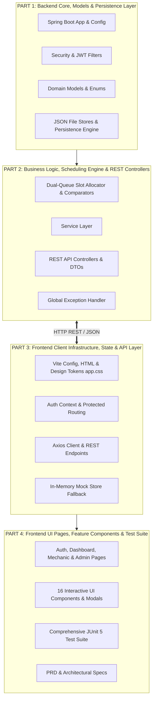

# 🛠️ AutoServe — Comprehensive Codebase Architecture & File Guide

> **Project Name:** AutoServe — Intelligent Vehicle Service Booking, Scheduling & Tracking Platform  
> **Tech Stack:** Spring Boot 3 (Java 17), Spring Security 6 (Stateless JWT), React 18, Vite 5, Vanilla Modern CSS  
> **Document Purpose:** This document explains the exact purpose and responsibility of every file in the codebase, structured into **4 cohesive architectural parts**.

---

## 🏛️ System Architecture Overview: The 4 Core Parts

---

## 📦 PART 1: Backend Core, Data Models & Persistence Layer

Part 1 encapsulates the Spring Boot application configuration, stateless security authentication, domain entity models, and the JSON-backed persistence storage engine that manages data without external database dependencies.

### 1.1 Spring Boot Core & Configuration
* **[`backend/pom.xml`](file:///c:/Users/vedan/OneDrive/Desktop/Vehicle%20Service%20Service/backend/pom.xml)**  
  Maven Project Object Model file defining project dependencies: Spring Boot Starter Web, Spring Boot Starter Security, JJWT (0.11.5) for token handling, Jackson for JSON parsing, and Spring Boot Starter Test with JUnit 5.
* **[`backend/src/main/resources/application.properties`](file:///c:/Users/vedan/OneDrive/Desktop/Vehicle%20Service%20Service/backend/src/main/resources/application.properties)**  
  Application configuration defining the server port (`8080`), file storage directory path (`./data`), and default security credentials.
* **[`backend/src/main/java/com/vehicleservice/VehicleServiceApplication.java`](file:///c:/Users/vedan/OneDrive/Desktop/Vehicle%20Service%20Service/backend/src/main/java/com/vehicleservice/VehicleServiceApplication.java)**  
  Main Spring Boot entry point with `@SpringBootApplication` that bootstraps the server context and starts the embedded Tomcat container.
* **[`backend/src/main/java/com/vehicleservice/config/AppProperties.java`](file:///c:/Users/vedan/OneDrive/Desktop/Vehicle%20Service%20Service/backend/src/main/java/com/vehicleservice/config/AppProperties.java)**  
  Type-safe configuration reader mapping properties (`app.storage.dir`, `app.jwt.secret`, `app.jwt.expiration-ms`) for storage paths and JWT generation.
* **[`backend/src/main/java/com/vehicleservice/config/CorsConfig.java`](file:///c:/Users/vedan/OneDrive/Desktop/Vehicle%20Service%20Service/backend/src/main/java/com/vehicleservice/config/CorsConfig.java)**  
  Configures Cross-Origin Resource Sharing (CORS) allowing the React frontend (`http://localhost:5173`, `http://localhost:3000`) to send authenticated requests (`GET`, `POST`, `PUT`, `PATCH`, `DELETE`, `OPTIONS`).
* **[`backend/src/main/java/com/vehicleservice/config/JwtAuthFilter.java`](file:///c:/Users/vedan/OneDrive/Desktop/Vehicle%20Service%20Service/backend/src/main/java/com/vehicleservice/config/JwtAuthFilter.java)**  
  Once-per-request servlet filter intercepting incoming requests, extracting the `Bearer <token>` header, verifying claims via `JwtService`, and populating the Spring `SecurityContextHolder`.
* **[`backend/src/main/java/com/vehicleservice/config/SecurityConfig.java`](file:///c:/Users/vedan/OneDrive/Desktop/Vehicle%20Service%20Service/backend/src/main/java/com/vehicleservice/config/SecurityConfig.java)**  
  Defines Spring Security filter chain: enables stateless session management (`SessionCreationPolicy.STATELESS`), disables CSRF for REST APIs, configures role-based access rules, and registers the BCrypt password encoder.

---

### 1.2 Domain Models & Enumerations (`model/`)
* **[`backend/src/main/java/com/vehicleservice/model/User.java`](file:///c:/Users/vedan/OneDrive/Desktop/Vehicle%20Service%20Service/backend/src/main/java/com/vehicleservice/model/User.java)**  
  Entity representing an application user with ID, name, email, hashed password, assigned `Role`, and optional `workshopId` (for mechanics).
* **[`backend/src/main/java/com/vehicleservice/model/Role.java`](file:///c:/Users/vedan/OneDrive/Desktop/Vehicle%20Service%20Service/backend/src/main/java/com/vehicleservice/model/Role.java)**  
  Enum defining user authority tiers: `CUSTOMER`, `MECHANIC`, and `ADMIN`.
* **[`backend/src/main/java/com/vehicleservice/model/Vehicle.java`](file:///c:/Users/vedan/OneDrive/Desktop/Vehicle%20Service%20Service/backend/src/main/java/com/vehicleservice/model/Vehicle.java)**  
  Represents a registered vehicle with license registration number (e.g., `MH12AB1234`), owner reference, model name, category, and sub-type.
* **[`backend/src/main/java/com/vehicleservice/model/Category.java`](file:///c:/Users/vedan/OneDrive/Desktop/Vehicle%20Service%20Service/backend/src/main/java/com/vehicleservice/model/Category.java)**  
  Vehicle classification enum: `TWO_WHEELER`, `THREE_WHEELER`, `FOUR_WHEELER`, and `HEAVY`.
* **[`backend/src/main/java/com/vehicleservice/model/VehicleTree.java`](file:///c:/Users/vedan/OneDrive/Desktop/Vehicle%20Service%20Service/backend/src/main/java/com/vehicleservice/model/VehicleTree.java)**  
  Tree data structure for sub-type categorization (e.g., Scooter vs Geared for 2-Wheelers; Petrol, Diesel, CNG, EV for 4-Wheelers).
* **[`backend/src/main/java/com/vehicleservice/model/ServiceItem.java`](file:///c:/Users/vedan/OneDrive/Desktop/Vehicle%20Service%20Service/backend/src/main/java/com/vehicleservice/model/ServiceItem.java)**  
  Service catalog definition detailing service ID, name, target vehicle category/sub-type, base price, expected duration in minutes, and assigned queue class.
* **[`backend/src/main/java/com/vehicleservice/model/QueueClass.java`](file:///c:/Users/vedan/OneDrive/Desktop/Vehicle%20Service%20Service/backend/src/main/java/com/vehicleservice/model/QueueClass.java)**  
  Enum for task routing: `SHORT` (duration &le; 120 mins) vs `LONG` (duration > 120 mins).
* **[`backend/src/main/java/com/vehicleservice/model/Workshop.java`](file:///c:/Users/vedan/OneDrive/Desktop/Vehicle%20Service%20Service/backend/src/main/java/com/vehicleservice/model/Workshop.java)**  
  Represents a physical workshop center with ID, commercial name, location address, and contact number.
* **[`backend/src/main/java/com/vehicleservice/model/Mechanic.java`](file:///c:/Users/vedan/OneDrive/Desktop/Vehicle%20Service%20Service/backend/src/main/java/com/vehicleservice/model/Mechanic.java)**  
  Represents a technician assigned to a workshop, along with a list of certified vehicle categories they are qualified to service.
* **[`backend/src/main/java/com/vehicleservice/model/Slot.java`](file:///c:/Users/vedan/OneDrive/Desktop/Vehicle%20Service%20Service/backend/src/main/java/com/vehicleservice/model/Slot.java)**  
  Time slot block representation detailing start time, duration, and mechanic capacity availability.
* **[`backend/src/main/java/com/vehicleservice/model/Booking.java`](file:///c:/Users/vedan/OneDrive/Desktop/Vehicle%20Service%20Service/backend/src/main/java/com/vehicleservice/model/Booking.java)**  
  Composite booking order referencing customer ID, vehicle registration, target date, assigned job IDs, and overall completion timestamp.
* **[`backend/src/main/java/com/vehicleservice/model/Job.java`](file:///c:/Users/vedan/OneDrive/Desktop/Vehicle%20Service%20Service/backend/src/main/java/com/vehicleservice/model/Job.java)**  
  Discrete unit of work within a booking detailing service name, assigned mechanic, time slot window (`slotStart` to `estimatedEnd`), `JobStatus`, and technician notes.
* **[`backend/src/main/java/com/vehicleservice/model/JobStatus.java`](file:///c:/Users/vedan/OneDrive/Desktop/Vehicle%20Service%20Service/backend/src/main/java/com/vehicleservice/model/JobStatus.java)**  
  Workflow status enum: `PENDING`, `IN_PROGRESS`, and `COMPLETED`.
* **[`backend/src/main/java/com/vehicleservice/model/Bill.java`](file:///c:/Users/vedan/OneDrive/Desktop/Vehicle%20Service%20Service/backend/src/main/java/com/vehicleservice/model/Bill.java)**  
  Formal tax invoice record capturing subtotal, flat 18% GST calculation, grand total, and workshop metadata.
* **[`backend/src/main/java/com/vehicleservice/model/BillLine.java`](file:///c:/Users/vedan/OneDrive/Desktop/Vehicle%20Service%20Service/backend/src/main/java/com/vehicleservice/model/BillLine.java)**  
  Line item on a tax bill detailing specific service delivered, price, and mechanic in charge.
* **[`backend/src/main/java/com/vehicleservice/model/ServiceRecord.java`](file:///c:/Users/vedan/OneDrive/Desktop/Vehicle%20Service%20Service/backend/src/main/java/com/vehicleservice/model/ServiceRecord.java)**  
  Historical audit record persisted into the vehicle's maintenance stack for lifecycle tracking.

---

### 1.3 Persistence Engine, Stores & Data Files (`store/`, `data/`)
* **[`backend/src/main/java/com/vehicleservice/store/JsonFileStorage.java`](file:///c:/Users/vedan/OneDrive/Desktop/Vehicle%20Service%20Service/backend/src/main/java/com/vehicleservice/store/JsonFileStorage.java)**  
  Core persistence engine handling thread-safe JSON file read/write operations with auto-initialization, backup handling, and serialization locking.
* **[`backend/src/main/java/com/vehicleservice/store/UserStore.java`](file:///c:/Users/vedan/OneDrive/Desktop/Vehicle%20Service%20Service/backend/src/main/java/com/vehicleservice/store/UserStore.java)**  
  In-memory hash table repository with JSON backing for user lookups by email and ID.
* **[`backend/src/main/java/com/vehicleservice/store/VehicleStore.java`](file:///c:/Users/vedan/OneDrive/Desktop/Vehicle%20Service%20Service/backend/src/main/java/com/vehicleservice/store/VehicleStore.java)**  
  Repository managing vehicle registrations and vehicle-specific service record stacks.
* **[`backend/src/main/java/com/vehicleservice/store/CatalogStore.java`](file:///c:/Users/vedan/OneDrive/Desktop/Vehicle%20Service%20Service/backend/src/main/java/com/vehicleservice/store/CatalogStore.java)**  
  Repository managing service catalog items with filtering by category and sub-type.
* **[`backend/src/main/java/com/vehicleservice/store/WorkshopStore.java`](file:///c:/Users/vedan/OneDrive/Desktop/Vehicle%20Service%20Service/backend/src/main/java/com/vehicleservice/store/WorkshopStore.java)**  
  Repository storing workshop locations and contact details.
* **[`backend/src/main/java/com/vehicleservice/store/MechanicStore.java`](file:///c:/Users/vedan/OneDrive/Desktop/Vehicle%20Service%20Service/backend/src/main/java/com/vehicleservice/store/MechanicStore.java)**  
  Repository managing mechanic rosters and workshop associations.
* **[`backend/src/main/java/com/vehicleservice/store/BookingStore.java`](file:///c:/Users/vedan/OneDrive/Desktop/Vehicle%20Service%20Service/backend/src/main/java/com/vehicleservice/store/BookingStore.java)**  
  Repository recording customer service booking orders.
* **[`backend/src/main/java/com/vehicleservice/store/JobStore.java`](file:///c:/Users/vedan/OneDrive/Desktop/Vehicle%20Service%20Service/backend/src/main/java/com/vehicleservice/store/JobStore.java)**  
  Repository tracking discrete allocated jobs by mechanic ID, booking ID, and status.
* **[`backend/src/main/java/com/vehicleservice/store/BillStore.java`](file:///c:/Users/vedan/OneDrive/Desktop/Vehicle%20Service%20Service/backend/src/main/java/com/vehicleservice/store/BillStore.java)**  
  Repository storing generated tax invoices indexed by booking ID.
* **[`backend/src/main/resources/seed/catalog-seed.json`](file:///c:/Users/vedan/OneDrive/Desktop/Vehicle%20Service%20Service/backend/src/main/resources/seed/catalog-seed.json)**  
  Default catalog seed data populated when the system starts for the first time.
* **[`backend/data/catalog.json`](file:///c:/Users/vedan/OneDrive/Desktop/Vehicle%20Service%20Service/backend/data/catalog.json)** & **[`backend/data/workshops.json`](file:///c:/Users/vedan/OneDrive/Desktop/Vehicle%20Service%20Service/backend/data/workshops.json)**  
  Live JSON persistence files for active catalog services and workshop locations.

---

## ⚙️ PART 2: Business Logic, Scheduling Engine & REST Controllers

Part 2 houses the core algorithmic mechanics of AutoServe: dual-priority slot allocation, queue starvation aging tasks, domain services, DTO data contracts, and REST controllers.

### 2.1 Dual-Queue Scheduling & Slot Allocation (`scheduler/`)
* **[`backend/src/main/java/com/vehicleservice/scheduler/SlotAllocator.java`](file:///c:/Users/vedan/OneDrive/Desktop/Vehicle%20Service%20Service/backend/src/main/java/com/vehicleservice/scheduler/SlotAllocator.java)**  
  The core scheduling algorithm that allocates jobs into morning/afternoon mechanic slots. Segregates incoming tasks into Short and Long priority queues, finds qualified available mechanics, and chains sequential slot windows.
* **[`backend/src/main/java/com/vehicleservice/scheduler/ShortJobComparator.java`](file:///c:/Users/vedan/OneDrive/Desktop/Vehicle%20Service%20Service/backend/src/main/java/com/vehicleservice/scheduler/ShortJobComparator.java)**  
  Priority comparator for short-queue tasks (sorts primarily by Shortest Job First / duration).
* **[`backend/src/main/java/com/vehicleservice/scheduler/LongJobComparator.java`](file:///c:/Users/vedan/OneDrive/Desktop/Vehicle%20Service%20Service/backend/src/main/java/com/vehicleservice/scheduler/LongJobComparator.java)**  
  Priority comparator for complex overhaul jobs (balances duration and FIFO order).
* **[`backend/src/main/java/com/vehicleservice/scheduler/AgingTask.java`](file:///c:/Users/vedan/OneDrive/Desktop/Vehicle%20Service%20Service/backend/src/main/java/com/vehicleservice/scheduler/AgingTask.java)**  
  Starvation-prevention task that promotes aging jobs in the long queue to prevent priority starvation by an influx of short tasks.

---

### 2.2 Service Layer (`service/`)
* **[`backend/src/main/java/com/vehicleservice/service/AuthService.java`](file:///c:/Users/vedan/OneDrive/Desktop/Vehicle%20Service%20Service/backend/src/main/java/com/vehicleservice/service/AuthService.java)**  
  Handles user registration, BCrypt password hashing, credential validation, and JWT token issuance upon login.
* **[`backend/src/main/java/com/vehicleservice/service/JwtService.java`](file:///c:/Users/vedan/OneDrive/Desktop/Vehicle%20Service%20Service/backend/src/main/java/com/vehicleservice/service/JwtService.java)**  
  HMAC-SHA256 token generation and validation utility encoding user claims (ID, email, role).
* **[`backend/src/main/java/com/vehicleservice/service/VehicleService.java`](file:///c:/Users/vedan/OneDrive/Desktop/Vehicle%20Service%20Service/backend/src/main/java/com/vehicleservice/service/VehicleService.java)**  
  Validates and registers vehicles under customer accounts and fetches historical maintenance stacks.
* **[`backend/src/main/java/com/vehicleservice/service/CatalogService.java`](file:///c:/Users/vedan/OneDrive/Desktop/Vehicle%20Service%20Service/backend/src/main/java/com/vehicleservice/service/CatalogService.java)**  
  Queries and filters available services matching vehicle category and sub-type; supports admin catalog updates.
* **[`backend/src/main/java/com/vehicleservice/service/BookingService.java`](file:///c:/Users/vedan/OneDrive/Desktop/Vehicle%20Service%20Service/backend/src/main/java/com/vehicleservice/service/BookingService.java)**  
  Coordinates multi-slot booking creation, invokes `SlotAllocator`, creates discrete `Job` records, and handles invoice generation upon booking completion.
* **[`backend/src/main/java/com/vehicleservice/service/MechanicService.java`](file:///c:/Users/vedan/OneDrive/Desktop/Vehicle%20Service%20Service/backend/src/main/java/com/vehicleservice/service/MechanicService.java)**  
  Provides mechanic queue retrieval, updates job status (`PENDING` &rarr; `IN_PROGRESS` &rarr; `COMPLETED`), and checks if all jobs in a booking are completed to trigger billing and service history updates.
* **[`backend/src/main/java/com/vehicleservice/service/BillingService.java`](file:///c:/Users/vedan/OneDrive/Desktop/Vehicle%20Service%20Service/backend/src/main/java/com/vehicleservice/service/BillingService.java)**  
  Calculates itemized pricing, subtotal, 18% GST, and builds formal `Bill` entities.
* **[`backend/src/main/java/com/vehicleservice/service/AdminService.java`](file:///c:/Users/vedan/OneDrive/Desktop/Vehicle%20Service%20Service/backend/src/main/java/com/vehicleservice/service/AdminService.java)**  
  Manages administrative creation of workshop centers, mechanic onboarding, and cross-system booking audits.
* **[`backend/src/main/java/com/vehicleservice/service/SchedulerService.java`](file:///c:/Users/vedan/OneDrive/Desktop/Vehicle%20Service%20Service/backend/src/main/java/com/vehicleservice/service/SchedulerService.java)**  
  Thin adapter orchestrating queue allocation calls between `BookingService` and `SlotAllocator`.

---

### 2.3 REST API Controllers & DTOs (`controller/`, `dto/`, `exception/`)
* **[`backend/src/main/java/com/vehicleservice/controller/AuthController.java`](file:///c:/Users/vedan/OneDrive/Desktop/Vehicle%20Service%20Service/backend/src/main/java/com/vehicleservice/controller/AuthController.java)**  
  Public authentication endpoints: `POST /api/auth/signup` and `POST /api/auth/login`.
* **[`backend/src/main/java/com/vehicleservice/controller/VehicleController.java`](file:///c:/Users/vedan/OneDrive/Desktop/Vehicle%20Service%20Service/backend/src/main/java/com/vehicleservice/controller/VehicleController.java)**  
  Customer vehicle endpoints: `GET /api/vehicles`, `POST /api/vehicles`, and `GET /api/vehicles/{regNo}/history`.
* **[`backend/src/main/java/com/vehicleservice/controller/CatalogController.java`](file:///c:/Users/vedan/OneDrive/Desktop/Vehicle%20Service%20Service/backend/src/main/java/com/vehicleservice/controller/CatalogController.java)**  
  Catalog endpoint: `GET /api/services` with category and subType query filters.
* **[`backend/src/main/java/com/vehicleservice/controller/BookingController.java`](file:///c:/Users/vedan/OneDrive/Desktop/Vehicle%20Service%20Service/backend/src/main/java/com/vehicleservice/controller/BookingController.java)**  
  Booking endpoints: `POST /api/bookings` and `GET /api/bookings`.
* **[`backend/src/main/java/com/vehicleservice/controller/MechanicController.java`](file:///c:/Users/vedan/OneDrive/Desktop/Vehicle%20Service%20Service/backend/src/main/java/com/vehicleservice/controller/MechanicController.java)**  
  Technician console endpoints: `GET /api/mechanic/jobs` and `PATCH /api/mechanic/jobs/{jobId}/status`.
* **[`backend/src/main/java/com/vehicleservice/controller/BillController.java`](file:///c:/Users/vedan/OneDrive/Desktop/Vehicle%20Service%20Service/backend/src/main/java/com/vehicleservice/controller/BillController.java)**  
  Invoice endpoint: `GET /api/bills/{bookingId}` for retrieving official tax receipts.
* **[`backend/src/main/java/com/vehicleservice/controller/AdminController.java`](file:///c:/Users/vedan/OneDrive/Desktop/Vehicle%20Service%20Service/backend/src/main/java/com/vehicleservice/controller/AdminController.java)**  
  Admin operations endpoints for workshops, mechanics, catalog updates, and all system bookings.
* **DTOs (`dto/`)**:
  - `SignupRequest.java` & `LoginRequest.java`: Auth input contracts.
  - `AuthResponse.java`: JWT token and user payload returned on authentication.
  - `VehicleRequest.java`: Input contract for registering new vehicles.
  - `BookingRequest.java` & `BookingResponse.java`: Input/output for booking multi-slot appointments.
  - `JobStatusRequest.java`: Input for advancing a job status with diagnostic notes.
  - `WorkshopRequest.java` & `MechanicRequest.java`: Administrative creation contracts.
  - `BillResponse.java`: Structured invoice response with itemized tax amounts.
* **Exception Handlers (`exception/`)**:
  - `ApiException.java`: Custom runtime exception with HTTP status codes and error messages.
  - `GlobalExceptionHandler.java`: `@RestControllerAdvice` converting unhandled exceptions into uniform JSON error envelopes.

---

## 🌐 PART 3: Frontend Client Infrastructure, State & API Layer

Part 3 covers Vite build tooling, fonts, modern CSS tokens, authentication context, route protection, API Axios clients, and resilient in-memory mock fallback stores.

### 3.1 Build Tools, Environment & Design System
* **[`frontend/package.json`](file:///c:/Users/vedan/OneDrive/Desktop/Vehicle%20Service%20Service/frontend/package.json)**  
  Defines client dependencies: React 18, React DOM, React Router DOM 6, Axios, and Vite build scripts (`dev`, `build`, `preview`).
* **[`frontend/vite.config.js`](file:///c:/Users/vedan/OneDrive/Desktop/Vehicle%20Service%20Service/frontend/vite.config.js)**  
  Vite configuration file enabling the official `@vitejs/plugin-react` plugin for fast HMR (Hot Module Replacement).
* **[`frontend/index.html`](file:///c:/Users/vedan/OneDrive/Desktop/Vehicle%20Service%20Service/frontend/index.html)**  
  Application HTML shell loading Google Fonts (**Outfit**, **Plus Jakarta Sans**, and **JetBrains Mono**) and mounting the React root.
* **[`frontend/.env`](file:///c:/Users/vedan/OneDrive/Desktop/Vehicle%20Service%20Service/frontend/.env)** & **[`frontend/.env.example`](file:///c:/Users/vedan/OneDrive/Desktop/Vehicle%20Service%20Service/frontend/.env.example)**  
  Client environment configuration setting `VITE_API_BASE_URL` and `VITE_USE_MOCK`.
* **[`frontend/src/styles/app.css`](file:///c:/Users/vedan/OneDrive/Desktop/Vehicle%20Service%20Service/frontend/src/styles/app.css)**  
  Comprehensive CSS design system containing dark-mode color tokens, frosted glass cards (`backdrop-filter`), pulse animations, buttons, tables, Kanban boards, and print media rules.

---

### 3.2 State Management, Routing & Utilities
* **[`frontend/src/main.jsx`](file:///c:/Users/vedan/OneDrive/Desktop/Vehicle%20Service%20Service/frontend/src/main.jsx)**  
  Root React entry point initializing `BrowserRouter`, `AuthProvider`, and rendering `App.jsx`.
* **[`frontend/src/App.jsx`](file:///c:/Users/vedan/OneDrive/Desktop/Vehicle%20Service%20Service/frontend/src/App.jsx)**  
  Central router mapping paths (`/auth`, `/dashboard`, `/mechanic`, `/admin`, `/`) to corresponding page views wrapped in role-based guards.
* **[`frontend/src/context/AuthContext.jsx`](file:///c:/Users/vedan/OneDrive/Desktop/Vehicle%20Service%20Service/frontend/src/context/AuthContext.jsx)**  
  React Context managing authentication state, JWT tokens, active user profile, and synchronized `localStorage` persistence.
* **[`frontend/src/routes/ProtectedRoute.jsx`](file:///c:/Users/vedan/OneDrive/Desktop/Vehicle%20Service%20Service/frontend/src/routes/ProtectedRoute.jsx)**  
  Route wrapper ensuring unauthenticated users are redirected to `/auth`, and unauthorized roles are blocked from restricted portals.
* **[`frontend/src/utils/constants.js`](file:///c:/Users/vedan/OneDrive/Desktop/Vehicle%20Service%20Service/frontend/src/utils/constants.js)**  
  Shared UI constants defining vehicle categories (`TWO_WHEELER`, etc.), sub-types, job statuses, and queue classes.
* **[`frontend/src/utils/formatters.js`](file:///c:/Users/vedan/OneDrive/Desktop/Vehicle%20Service%20Service/frontend/src/utils/formatters.js)**  
  Formatting utilities for Indian Rupee currency (`formatCurrency`), human-readable dates (`formatDate`), and duration strings (`formatDuration`).

---

### 3.3 HTTP Client, API Modules & Resilient Mock Fallback (`api/`)
* **[`frontend/src/api/axiosClient.js`](file:///c:/Users/vedan/OneDrive/Desktop/Vehicle%20Service%20Service/frontend/src/api/axiosClient.js)**  
  Configured Axios instance attaching JWT Bearer tokens to request headers and handling automatic 401 token expiry logout redirects.
* **[`frontend/src/api/authApi.js`](file:///c:/Users/vedan/OneDrive/Desktop/Vehicle%20Service%20Service/frontend/src/api/authApi.js)**  
  Client module for login and signup with network fallback to `mockStore`.
* **[`frontend/src/api/vehicleApi.js`](file:///c:/Users/vedan/OneDrive/Desktop/Vehicle%20Service%20Service/frontend/src/api/vehicleApi.js)**  
  Client module for vehicle listing, vehicle registration, and historical maintenance stack fetching.
* **[`frontend/src/api/catalogApi.js`](file:///c:/Users/vedan/OneDrive/Desktop/Vehicle%20Service%20Service/frontend/src/api/catalogApi.js)**  
  Client module for retrieving category/sub-type services and administrative catalog updates.
* **[`frontend/src/api/bookingApi.js`](file:///c:/Users/vedan/OneDrive/Desktop/Vehicle%20Service%20Service/frontend/src/api/bookingApi.js)**  
  Client module for dispatching new booking requests and retrieving past orders.
* **[`frontend/src/api/mechanicApi.js`](file:///c:/Users/vedan/OneDrive/Desktop/Vehicle%20Service%20Service/frontend/src/api/mechanicApi.js)**  
  Client module for fetching assigned technician jobs and submitting work notes.
* **[`frontend/src/api/billApi.js`](file:///c:/Users/vedan/OneDrive/Desktop/Vehicle%20Service%20Service/frontend/src/api/billApi.js)**  
  Client module for fetching official tax invoices by booking ID.
* **[`frontend/src/api/adminApi.js`](file:///c:/Users/vedan/OneDrive/Desktop/Vehicle%20Service%20Service/frontend/src/api/adminApi.js)**  
  Client module for administrative creation of workshops, mechanics, and system audits.
* **[`frontend/src/api/mockData.js`](file:///c:/Users/vedan/OneDrive/Desktop/Vehicle%20Service%20Service/frontend/src/api/mockData.js)**  
  Rich in-memory simulation store implementing realistic demo users, vehicles, catalog items, slot dispatching, and billing calculations to ensure 100% UI functionality even when running standalone without the backend.

---

## 🖥️ PART 4: Frontend UI Pages, Feature Components & Test Suite

Part 4 contains the interactive presentation layer (all 4 portal pages and 16 modular UI components), alongside the automated JUnit 5 test suite and architectural specifications.

### 4.1 Application Pages (`pages/`)
* **[`frontend/src/pages/AuthPage.jsx`](file:///c:/Users/vedan/OneDrive/Desktop/Vehicle%20Service%20Service/frontend/src/pages/AuthPage.jsx)**  
  Split-screen authentication page featuring an engineering showcase hero banner on the left and tabbed Sign In / Sign Up controls on the right.
* **[`frontend/src/pages/DashboardPage.jsx`](file:///c:/Users/vedan/OneDrive/Desktop/Vehicle%20Service%20Service/frontend/src/pages/DashboardPage.jsx)**  
  Customer hub displaying registered vehicles, quick registration, multi-slot booking scheduler, and the historical service timeline.
* **[`frontend/src/pages/MechanicPage.jsx`](file:///c:/Users/vedan/OneDrive/Desktop/Vehicle%20Service%20Service/frontend/src/pages/MechanicPage.jsx)**  
  Workshop console for technicians featuring interactive KPI filter cards, quick search, and a view mode toggle between **Data Table** and **Kanban Board**.
* **[`frontend/src/pages/AdminPage.jsx`](file:///c:/Users/vedan/OneDrive/Desktop/Vehicle%20Service%20Service/frontend/src/pages/AdminPage.jsx)**  
  Enterprise operations console with executive KPI cards, tabbed views for Workshop Hubs, Certified Mechanics, and All Bookings, plus booking audit drawers.

---

### 4.2 Interactive UI Components (`components/`)
* **[`frontend/src/components/Navbar.jsx`](file:///c:/Users/vedan/OneDrive/Desktop/Vehicle%20Service%20Service/frontend/src/components/Navbar.jsx)**  
  Sticky header featuring the AutoServe brand emblem, live system indicator dot, initials monogram avatar, and a **1-Click Persona Switcher (`⚡ Switch Role`)** to jump between Customer, Mechanic, and Admin personas instantly.
* **[`frontend/src/components/LoginForm.jsx`](file:///c:/Users/vedan/OneDrive/Desktop/Vehicle%20Service%20Service/frontend/src/components/LoginForm.jsx)**  
  Sign-in form with 1-click demo chips (`Customer`, `Mechanic`, `Admin`), password visibility toggle, and loading spinners.
* **[`frontend/src/components/SignupForm.jsx`](file:///c:/Users/vedan/OneDrive/Desktop/Vehicle%20Service%20Service/frontend/src/components/SignupForm.jsx)**  
  Customer account creation form with real-time password strength indicators and validation.
* **[`frontend/src/components/VehicleCard.jsx`](file:///c:/Users/vedan/OneDrive/Desktop/Vehicle%20Service%20Service/frontend/src/components/VehicleCard.jsx)**  
  Interactive vehicle card featuring metallic license plate badges, category icons, fuel sub-type pills, and active selection glow rings.
* **[`frontend/src/components/AddVehicleForm.jsx`](file:///c:/Users/vedan/OneDrive/Desktop/Vehicle%20Service%20Service/frontend/src/components/AddVehicleForm.jsx)**  
  Vehicle registration form with visual category selector cards (2-Wheeler, 3-Wheeler, 4-Wheeler, Heavy) and license plate helpers.
* **[`frontend/src/components/BookingForm.jsx`](file:///c:/Users/vedan/OneDrive/Desktop/Vehicle%20Service%20Service/frontend/src/components/BookingForm.jsx)**  
  Step-by-step booking form with relative date selector pills (`Tomorrow`, `In 2 Days`), service selector, live turnaround duration, and 18% GST calculation.
* **[`frontend/src/components/ServicePicker.jsx`](file:///c:/Users/vedan/OneDrive/Desktop/Vehicle%20Service%20Service/frontend/src/components/ServicePicker.jsx)**  
  Catalog service selector with text search, Fast Turnaround (`⚡ SHORT`) and Deep Inspection (`⚙️ LONG`) queue filters, and animated checkmarks.
* **[`frontend/src/components/BookingConfirmation.jsx`](file:///c:/Users/vedan/OneDrive/Desktop/Vehicle%20Service%20Service/frontend/src/components/BookingConfirmation.jsx)**  
  Modal dialog displaying confirmed booking reference, allocated time slot windows, assigned certified mechanics, and print action.
* **[`frontend/src/components/ServiceHistoryList.jsx`](file:///c:/Users/vedan/OneDrive/Desktop/Vehicle%20Service%20Service/frontend/src/components/ServiceHistoryList.jsx)**  
  Vertical maintenance history timeline with glowing connection line, operations chips, mechanic tags, and "Tax Invoice" view trigger.
* **[`frontend/src/components/BillView.jsx`](file:///c:/Users/vedan/OneDrive/Desktop/Vehicle%20Service%20Service/frontend/src/components/BillView.jsx)**  
  Official luxury printed tax invoice modal featuring GSTIN headers, customer/vehicle metadata, itemized pricing table, and `window.print()` support.
* **[`frontend/src/components/JobTable.jsx`](file:///c:/Users/vedan/OneDrive/Desktop/Vehicle%20Service%20Service/frontend/src/components/JobTable.jsx)**  
  Data table for mechanic service jobs displaying vehicle license tags, queue badges, slot timings, and status action buttons.
* **[`frontend/src/components/JobStatusButtons.jsx`](file:///c:/Users/vedan/OneDrive/Desktop/Vehicle%20Service%20Service/frontend/src/components/JobStatusButtons.jsx)**  
  Workflow state transitions (`Start Job`, `Confirm Completion`) and modal dialog featuring **One-Click Diagnostic Preset Pills** for quick work notes.
* **[`frontend/src/components/StatusBadge.jsx`](file:///c:/Users/vedan/OneDrive/Desktop/Vehicle%20Service%20Service/frontend/src/components/StatusBadge.jsx)**  
  Micro-component rendering color-coded status badges with icons and pulse dots (`PENDING`, `IN_PROGRESS`, `COMPLETED`).
* **[`frontend/src/components/WorkshopForm.jsx`](file:///c:/Users/vedan/OneDrive/Desktop/Vehicle%20Service%20Service/frontend/src/components/WorkshopForm.jsx)**  
  Administrative modal form for registering new physical workshop centers with address and contact fields.
* **[`frontend/src/components/MechanicForm.jsx`](file:///c:/Users/vedan/OneDrive/Desktop/Vehicle%20Service%20Service/frontend/src/components/MechanicForm.jsx)**  
  Administrative modal form for onboarding certified mechanic specialists with multi-category capability chips.
* **[`frontend/src/components/DataTable.jsx`](file:///c:/Users/vedan/OneDrive/Desktop/Vehicle%20Service%20Service/frontend/src/components/DataTable.jsx)**  
  Reusable data table component with custom cell renderers, sorting alignments, and empty state illustrations.

---

### 4.3 Automated Test Suite & Architecture Documents
* **[`backend/src/test/java/com/vehicleservice/AuthAndVehicleTests.java`](file:///c:/Users/vedan/OneDrive/Desktop/Vehicle%20Service%20Service/backend/src/test/java/com/vehicleservice/AuthAndVehicleTests.java)**  
  Unit and integration tests verifying user registration, duplicate email handling, BCrypt hashing, JWT issuance, and vehicle validation.
* **[`backend/src/test/java/com/vehicleservice/BookingAndSchedulerTests.java`](file:///c:/Users/vedan/OneDrive/Desktop/Vehicle%20Service%20Service/backend/src/test/java/com/vehicleservice/BookingAndSchedulerTests.java)**  
  Tests verifying multi-slot allocation, morning/afternoon slot window calculations, and mechanic category assignment.
* **[`backend/src/test/java/com/vehicleservice/MechanicAdminBillingTests.java`](file:///c:/Users/vedan/OneDrive/Desktop/Vehicle%20Service%20Service/backend/src/test/java/com/vehicleservice/MechanicAdminBillingTests.java)**  
  Tests for job status progression, admin onboarding of workshops/mechanics, and GST tax invoice arithmetic.
* **[`backend/src/test/java/com/vehicleservice/SchedulerQueuesHashingBillingComprehensiveTests.java`](file:///c:/Users/vedan/OneDrive/Desktop/Vehicle%20Service%20Service/backend/src/test/java/com/vehicleservice/SchedulerQueuesHashingBillingComprehensiveTests.java)**  
  End-to-end suite verifying queue priority comparators, aging tasks, hashing tables, and concurrent bookings.
* **[`backend/src/test/java/com/vehicleservice/VehicleServiceApplicationTests.java`](file:///c:/Users/vedan/OneDrive/Desktop/Vehicle%20Service%20Service/backend/src/test/java/com/vehicleservice/VehicleServiceApplicationTests.java)**  
  Smoke test verifying Spring Boot application context loads cleanly.
* **[`README.md`](file:///c:/Users/vedan/OneDrive/Desktop/Vehicle%20Service%20Service/README.md)**  
  Project readme containing quickstart instructions, environment variables, and run commands.
* **[`PRD_Vehicle_Service_Booking_V2.md`](file:///c:/Users/vedan/OneDrive/Desktop/Vehicle%20Service%20Service/PRD_Vehicle_Service_Booking_V2.md)**  
  Product Requirements Document detailing functional specifications, data models, and business logic requirements.
* **[`Architecture_Vehicle_Service_Booking.md`](file:///c:/Users/vedan/OneDrive/Desktop/Vehicle%20Service%20Service/Architecture_Vehicle_Service_Booking.md)**  
  High-level architectural blueprint outlining data structures, hashing stores, and scheduling logic.

---

## 📊 Summary File Count Matrix

| Codebase Section | Directory / Layer | File Count |
| :--- | :--- | :---: |
| **Part 1** | Backend Config, Models & Persistence Layer | **29 files** |
| **Part 2** | Backend Business Logic, Scheduler & Controllers | **23 files** |
| **Part 3** | Frontend Client Infra, State & API Layer | **22 files** |
| **Part 4** | Frontend Pages, Components, Tests & Specs | **28 files** |
| **Total** | **Entire AutoServe Codebase** | **102 files** |
