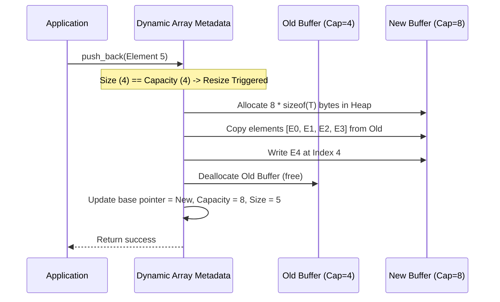
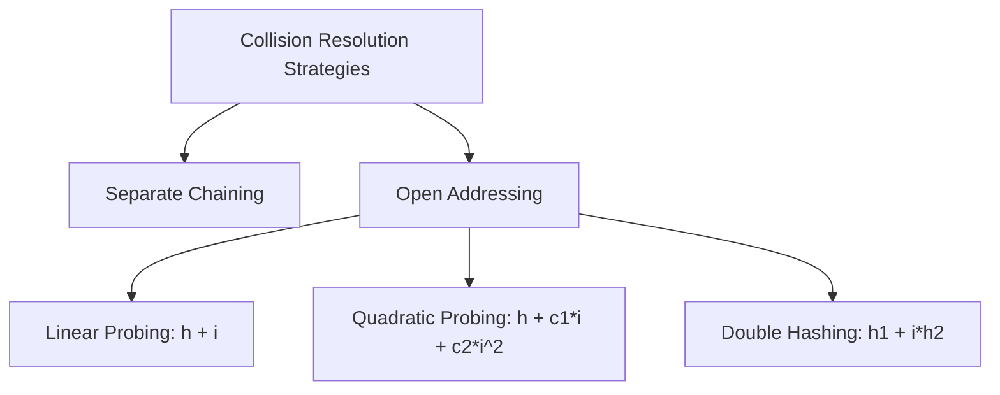

# Comprehensive Data Structures: Architecture, Physical Memory Representation, Invariant Logic & Academic Faculty Pitch Guide

---

## Executive Summary & Academic Pitch Blueprint

### 1. The Core Thesis for Faculty
> **"A Data Structure is not merely a collection of values; it is an architectural contract between physical hardware memory layouts, algorithmic invariants, and operational trade-offs."**

When presenting data structures to academic faculty or an evaluation committee, the fundamental objective is to demonstrate that data structures are understood not as isolated textbook recipes, but at three interconnected levels of abstraction:

```
+-------------------------------------------------------------------------------+
| Level 3: Theoretical / ADT Layer (Abstract Data Types, Big-O, Math Invariants)|
+-------------------------------------------------------------------------------+
                                      |
                                      v
+-------------------------------------------------------------------------------+
| Level 2: Logical / Algorithmic Layer (Pointer rewiring, rebalancing, hashing) |
+-------------------------------------------------------------------------------+
                                      |
                                      v
+-------------------------------------------------------------------------------+
| Level 1: Physical / Hardware Layer (Virtual Memory, Cache Lines, RAM, Bits)  |
+-------------------------------------------------------------------------------+
```

1. **Physical Hardware & Memory Layer:** How bits, bytes, word alignments, CPU cache lines (L1/L2/L3), stack frames, and heap allocators actually store and fetch elements.
2. **Algorithmic Logic & Invariant Maintenance:** How operations (insert, delete, search, rotate) preserve structural guarantees (e.g., BST property, heap property, Red-Black color constraints, load factors).
3. **Complexity & Amortization Theory:** Rigorous mathematical proofs of asymptotic time/space bounds ($O, \Omega, \Theta$) and amortized cost analyses (potential method, accounting method).

---

## Part I: The Physical & Logical Foundations of Data Storage

### 1. Memory Organization at the Hardware & OS Level
Every digital computer views main memory (RAM) as a massive, 1-dimensional array of byte-addressable memory cells. Each byte has an integer index known as its **Memory Address**.

```
Memory Address (Hex)    Byte Content        Hardware Context
0x7FFE0000              [ 01000001 ]        'A' (char)
0x7FFE0001              [ 00000000 ]        padding / byte 1 of int
0x7FFE0002              [ 00000000 ]        byte 2 of int
0x7FFE0003              [ 00000101 ]        byte 3 of int (Value = 5)
0x7FFE0004              [ Pointer (64-bit address to Heap) ]
```

#### A. Stack vs. Heap Memory Allocation
| Dimension | Stack Memory | Heap Memory |
| :--- | :--- | :--- |
| **Allocation Mechanism** | Linear stack pointer decrement (`RSP` in x86-64). $O(1)$ push/pop. | Dynamic memory manager (e.g., `ptmalloc`, `jemalloc`). Free-list search, chunk splitting ($O(1)$ to $O(N)$). |
| **Lifetime** | Lexical scope (function invocation frame). Automatically reclaimed on return. | Explicit allocation and deallocation (or managed by Garbage Collector / Reference Counting). |
| **Locality** | Extremely high spatial & temporal cache locality. | Lower locality; risk of internal and external memory fragmentation. |
| **Data Structures Stored** | Local primitives, fixed-size static arrays, pointer variables themselves. | Dynamic arrays, linked list nodes, tree nodes, graph adjacency structures. |

#### B. Cache Lines and Spatial vs. Temporal Locality
Modern CPUs do not fetch individual bytes from RAM. When a memory address is accessed, the memory controller transfers a contiguous block—typically **64 bytes**—called a **Cache Line** into L1, L2, and L3 caches.

- **Spatial Locality:** Accessing memory address $A$ makes accessing $A + 1$ almost instantaneous because it already resides in the 64-byte cache line. (Crucial for Arrays).
- **Temporal Locality:** Accessing address $A$ now increases the probability that $A$ will be accessed again shortly.
- **Cache Miss Penalty:** An L1 cache hit takes $\approx 1$ ns ($\sim 4$ CPU cycles), whereas a main memory RAM access takes $\approx 50\text{--}100$ ns ($\sim 200\text{--}300$ cycles). A linked list traversal incurs continuous cache misses because node addresses are scattered across the heap, whereas an array traversal utilizes prefetching hardware.

#### C. Word Alignment and Data Packing
CPUs read 32-bit (4 bytes) or 64-bit (8 bytes) words aligned to memory boundaries divisible by 4 or 8.
- An integer (4 bytes) stored at address `0x1001` crosses two word boundaries, requiring **two bus cycles** plus bitwise shifting and masking to reconstruct the integer.
- Compilers introduce **padding bytes** inside `struct` or `class` representations in memory to align fields to natural boundary multiples.

---

## Part II: Core Data Structures — Memory Architecture & Operational Logic

```
                                  DATA STRUCTURES
                                         |
         +-------------------------------+-------------------------------+
         |                                                               |
    Linear Structures                                           Non-Linear Structures
         |                                                               |
    +----+----+----+----+                                       +--------+--------+
    |         |    |    |                                       |                 |
  Array     List Stack Queue                                  Trees             Graphs
 (Contig) (Node)                                                |                 |
                                                       +--------+--------+    Adjacency Matrix /
                                                       |                 |    Adjacency List
                                                      BST           Self-Balancing
                                                                    (AVL, Red-Black, B-Tree)
```

---

### 1. Arrays (Static and Dynamic)

#### A. Physical Storage Model
An array is a contiguous block of homogeneous memory cells. The memory location of any element $i$ can be calculated via **pure pointer arithmetic** in $O(1)$ deterministic time without traversing previous elements.

$$\text{Address}(A[i]) = \text{Base\_Address} + (i \times \text{sizeof}(\text{DataType}))$$

```
Base Address = 0x1000, Element Size = 4 bytes (int32)
Index:         0          1          2          3
Address:   [ 0x1000 ] [ 0x1004 ] [ 0x1008 ] [ 0x100C ]
Value:     [   42   ] [   18   ] [   99   ] [   -7   ]
```

#### B. Dynamic Array Scaling Logic (e.g., `std::vector`, `ArrayList`)
A dynamic array wraps a fixed heap-allocated array with two state variables:
1. `size` (number of active logical elements).
2. `capacity` (total allocated slots in the underlying memory block).

When `size == capacity`:
1. Allocate a new contiguous memory block of size $\text{capacity} \times \text{GrowthFactor}$ (typically $1.5\times$ in MSVC/C++, $2.0\times$ in GCC/Java).
2. Sequentially copy/move existing elements from old buffer to new buffer.
3. Free/deallocate the old memory buffer.
4. Update internal pointer to point to the new buffer.



#### C. Amortized Analysis via the Potential Method
- **Worst-case single insertion:** $O(N)$ when reallocation occurs.
- **Amortized cost:** $O(1)$.
- **Proof (Accounting Method):**
  - Assign each standard insertion a credit fee of $\$3$.
  - $\$1$ pays for inserting the element into the current slot.
  - $\$1$ is stored with this element to pay for moving it when the array doubles.
  - $\$1$ is placed on an earlier element (which already used its credit) to pay for moving that older element during the next doubling.
  - When the array reaches size $N$, exactly $\$N$ credits have accumulated, completely covering the $N$ copy operations. Thus, amortized cost per insertion is $\le 3 \implies O(1)$.

---

### 2. Linked Lists (Singly, Doubly, Skip Lists)

#### A. Physical Storage Model
Unlike arrays, linked lists are **non-contiguous**. Nodes are allocated independently across arbitrary addresses in the heap. Connectivity is maintained purely via memory address pointers stored within each node.

```
Singly Linked Node:
+-------------------+----------------------------+
|  Payload (Data)   |  Next Pointer (8 bytes)    |
|  e.g., 4-byte int |  Address of next heap node |
+-------------------+----------------------------+

Memory Reality:
Node A (at 0x3010): [ Data: 10 | Next: 0x9040 ] ------> Node B (at 0x9040): [ Data: 25 | Next: 0x1020 ]
                                                                                   |
                                                                                   v
                                                             Node C (at 0x1020): [ Data: 40 | Next: NULL ]
```

#### B. Memory Overhead Comparison
For storing 1,000,000 32-bit integers ($4\text{ MB}$ raw data):
- **Raw Array:** $10^6 \times 4\text{ bytes} \approx 4\text{ MB}$ (with 0 metadata overhead).
- **64-bit Singly Linked List:** Each node = $4\text{ bytes (data)} + 4\text{ bytes (alignment padding)} + 8\text{ bytes (pointer)} = 16\text{ bytes} \implies 16\text{ MB}$ ($300\%$ memory overhead).
- **64-bit Doubly Linked List:** $4\text{ bytes (data)} + 4\text{ bytes (padding)} + 8\text{ bytes (next)} + 8\text{ bytes (prev)} = 24\text{ bytes} \implies 24\text{ MB}$ ($500\%$ overhead).

#### C. Invariant Logic: Node Splice & Removal
In a Doubly Linked List, every internal node $X$ must satisfy the invariant:
$$X.\text{next}.\text{prev} == X \quad \text{and} \quad X.\text{prev}.\text{next} == X$$

To remove node $X$ safely without dangling pointers or memory leaks:
```c
// Pre-condition: X is non-null and not head/tail sentinel
X->prev->next = X->next;
X->next->prev = X->prev;
X->next = NULL;
X->prev = NULL;
free(X);
```

#### D. Skip Lists: Probabilistic Layering for $O(\log N)$ Search
A Skip List builds forward pointers over a sorted linked list using a geometric coin-flip distribution (probability $p = 1/2$ or $1/4$).
- **Level 0:** Contains all $N$ nodes.
- **Level $k$:** Contains roughly $N \cdot p^k$ nodes.
- **Search Logic:** Start at the highest header level. Step horizontally while `current->next->key < target`. If `current->next->key >= target`, drop down one level vertically. Repeat until Level 0.
- Guarantees $O(\log N)$ search, insertion, and deletion with zero tree rebalancing rotations.

---

### 3. Stacks & Queues: Controlled Access Abstractions

#### A. Stack (LIFO: Last-In, First-Out)
- **Mathematical Invariant:** If item $A$ was pushed before item $B$, $B$ must be popped before $A$.
- **Storage Implementations:**
  1. *Array-backed:* Uses a `top` integer index. Push is `arr[++top] = val`. Pop is `return arr[top--]`. Maximum performance due to cache locality and zero heap allocations once sized.
  2. *Linked-list-backed:* Push inserts at `head`. Pop removes `head`. Zero capacity limit, but allocates on each push.

#### B. Queue (FIFO: First-In, First-Out) and Circular Buffers
A naive array implementation shifts all elements on dequeue ($O(N)$ logic). To achieve $O(1)$ dequeue, a **Circular Buffer (Ring Buffer)** is used.

```
Array indices:   0     1     2     3     4     5     6     7
               [    |  A  |  B  |  C  |  D  |  E  |    |    ]
                       ^                       ^
                      Head                    Tail
```

- **Logic Formulations:**
  - $\text{Next\_Tail} = (\text{Tail} + 1) \pmod{\text{Capacity}}$
  - $\text{Next\_Head} = (\text{Head} + 1) \pmod{\text{Capacity}}$
  - **Empty Condition:** $\text{Head} == \text{Tail}$
  - **Full Condition:** $(\text{Tail} + 1) \pmod{\text{Capacity}} == \text{Head}$ (reserving 1 empty slot) or maintaining an explicit `count` variable.

---

### 4. Hash Tables: Associative Direct-Access Architecture

#### A. Physical Storage Mechanism
A Hash Table maps an arbitrary large key space $K$ into a finite array of slots $T[0 \dots m-1]$ via a **Hash Function** $h(k)$.

```
Key ("user_92") ---> [ Hash Function h(k) ] ---> Large Hash (e.g., 0xA94F6E12)
                                                             |
                                                             v
Index = Hash % Table_Size (e.g., 0xA94F6E12 % 1024 = 530) ---> Bucket[530]
```

#### B. Collision Resolution Strategies: Physical Memory Comparison


1. **Separate Chaining:**
   - Each bucket is a linked list or small balanced tree (e.g., Java 8+ switches from linked list to Red-Black Tree when a bucket exceeds 8 items).
   - *Advantage:* Graceful degradation when load factor $\alpha > 1$.
   - *Disadvantage:* High pointer dereferencing and memory fragmentation.

2. **Open Addressing (Closed Hashing - Linear Probing):**
   - All entries reside directly in the bucket array. If slot $h(k)$ is occupied, probe $(h(k) + i) \pmod m$ for $i = 1, 2, 3 \dots$.
   - *Advantage:* Superb cache locality; consecutive slots sit in the same cache line.
   - *Disadvantage:* **Primary Clustering** (long runs of occupied slots build up, causing probe lengths to spike).
   - **Tombstone Deletion Logic:** When deleting in Open Addressing, you cannot simply clear the slot to `NULL`. Doing so would break search chains for keys probed past this slot. Instead, write a special sentinel marker: `TOMBSTONE` (or `DELETED`). Search traverses past `TOMBSTONE`; insert can overwrite `TOMBSTONE`.

#### C. Load Factor and Dynamic Re-hashing
$$\text{Load Factor } \alpha = \frac{N \text{ (number of stored keys)}}{M \text{ (number of buckets)}}$$
- When $\alpha \ge \alpha_{\text{threshold}}$ (standard is $0.75$):
  1. Allocate new table of size $M_{\text{new}} = 2 \times M_{\text{old}}$.
  2. For every active element in old table, recompute $\text{new\_index} = h(k) \pmod{M_{\text{new}}}$.
  3. Re-insert every key-value pair into the new memory array.

---

### 5. Hierarchical Structures: Binary Search Trees & Self-Balancing Trees

#### A. The Binary Search Tree (BST) Invariant
For every node $X$:
$$\forall y \in \text{LeftSubtree}(X): y.\text{key} < X.\text{key}$$
$$\forall z \in \text{RightSubtree}(X): z.\text{key} > X.\text{key}$$

- **Degenerate Tree Problem:** Inserting strictly sorted data ($1, 2, 3, 4, 5$) causes the tree to degenerate into a linked list with height $H = N$, collapsing search complexity from $O(\log N)$ to $O(N)$.

#### B. AVL Trees: Height Balance Invariant
- **Invariant:** For every node $X$, the Balance Factor $BF(X) \in \{-1, 0, 1\}$, where:
  $$BF(X) = \text{Height}(\text{RightSubtree}(X)) - \text{Height}(\text{LeftSubtree}(X))$$
- **Rebalancing Logic via Tree Rotations:**
  Rotations are local pointer updates that restore height balance in $O(1)$ without violating the BST ordering invariant.

```
Right Rotation (LL Case):
          Z (BF = -2)                     Y
         / \                            /   \
        Y   T3      =======>           X     Z
       / \                            / \   / \
      X   T2                         T0 T1 T2 T3
     / \
    T0 T1
```

```c
// Right Rotation on Node Z
Node* rotateRight(Node* Z) {
    Node* Y = Z->left;
    Node* T2 = Y->right;

    // Pointer rewiring
    Y->right = Z;
    Z->left = T2;

    // Recalculate heights
    Z->height = 1 + max(getHeight(Z->left), getHeight(Z->right));
    Y->height = 1 + max(getHeight(Y->left), getHeight(Y->right));

    return Y; // New root of subtree
}
```

#### C. Red-Black Trees: Colored Invariants
Used internally in the Linux kernel (CFS scheduler), C++ STL (`std::map`, `std::set`), and Java (`TreeMap`).
- **5 Fundamental Invariants:**
  1. Every node is either **RED** or **BLACK**.
  2. The root node is always **BLACK**.
  3. All leaf nodes (`NIL` / sentinel nodes) are **BLACK**.
  4. If a node is **RED**, both of its children must be **BLACK** (no two consecutive RED nodes on any path).
  5. **Black Height Invariant:** Every simple path from a given node to any of its descendant `NIL` leaves contains the exact same number of black nodes.

- **Why Red-Black over AVL?**
  - AVL trees are strictly balanced ($\text{Height} \le 1.44 \log_2 N$), requiring more rotations on insertion/deletion.
  - Red-Black trees allow slightly looser balance ($\text{Height} \le 2 \log_2(N + 1)$), resulting in faster insertions and deletions (at most 2 rotations per insert, at most 3 rotations per delete).

#### D. B-Trees & B+ Trees: Disk & Block-Storage Optimizations
Modern relational databases (PostgreSQL, MySQL InnoDB) and file systems (NTFS, ext4) use B/B+ Trees rather than binary trees.
- **Physical Reason:** Disk reads/writes occur in pages (typically $4\text{ KB}$ or $16\text{ KB}$). A binary tree node contains 1 key and 2 child pointers ($\sim 32$ bytes), wasting $99\%$ of a disk page read.
- **B-Tree Design:** A node has a large branching factor (fan-out $M$, often $100\text{--}1000$). One node fits exactly into one hardware disk block/page.
- Height is suppressed to $\approx 3\text{--}4$ levels for billions of records, meaning only $3\text{--}4$ disk I/O operations are required to access any key.

---

### 6. Heaps & Priority Queues: Implicit Tree Storage in Arrays

#### A. The Heap Property
- **Min-Heap Invariant:** For every node $X$ other than the root:
  $$\text{Parent}(X).\text{key} \le X.\text{key}$$
- **Complete Binary Tree Property:** All levels are completely filled except possibly the bottom level, which is filled strictly from left to right.

#### B. The Array Embedding Logic (Zero Pointers)
Because the tree is structurally complete, it can be mapped into a flat array with **zero memory overhead for child/parent pointers**.

```
Tree Topology:
               (10) [Idx 0]
              /            \
       (25) [Idx 1]     (18) [Idx 2]
       /          \
  (40) [Idx 3]  (35) [Idx 4]

Array Memory:
Index:   [  0  ] [  1  ] [  2  ] [  3  ] [  4  ]
Value:   [ 10  ] [ 25  ] [ 18  ] [ 40  ] [ 35  ]
```

- **Pointerless Index Arithmetic:**
  - $\text{Parent}(i) = \lfloor (i - 1) / 2 \rfloor$
  - $\text{LeftChild}(i) = 2i + 1$
  - $\text{RightChild}(i) = 2i + 2$

#### C. Operational Logic: Swim (Sift-Up) and Sink (Sift-Down)
- **Insert:** Append to end of array (`arr[size]`). Call `swim(size)`: compare with parent; if child is smaller, swap with parent and repeat upwards. Runs in $O(\log N)$.
- **Extract-Min:** Swap `arr[0]` with `arr[size - 1]`. Decrement size. Call `sink(0)`: compare root with its smallest child; if child is smaller than root, swap and recurse downwards. Runs in $O(\log N)$.
- **Linear-Time Heap Construction (Floyd’s Algorithm):**
  Building a heap from an unsorted array takes $O(N)$ time, **not** $O(N \log N)$, by sinking nodes bottom-up from $\lfloor N/2 \rfloor - 1$ down to 0:
  $$\sum_{h=0}^{\lfloor \log N \rfloor} \frac{N}{2^{h+1}} \cdot O(h) = O\left(N \sum_{h=0}^{\infty} \frac{h}{2^h}\right) = O(2N) = O(N)$$

---

### 7. Graph Representations: Structural Memory Layouts

```
Graph:
    (0) ------- (1)
     |         / |
     |       /   |
     |     /     |
    (2) ------- (3)
```

#### A. Adjacency Matrix
A 2D array of size $|V| \times |V|$ where cell $M[u][v] = 1$ (or edge weight) if an edge exists.

```
      0   1   2   3
  0 [ 0,  1,  1,  0 ]
  1 [ 1,  0,  1,  1 ]
  2 [ 1,  1,  0,  1 ]
  3 [ 0,  1,  1,  0 ]
```
- **Memory Consumption:** $\Theta(|V|^2)$ bytes, regardless of edge count.
- **Hardware Profile:** Cache-friendly contiguous row access, but devastatingly wasteful for sparse graphs (e.g., social networks with $|V| = 10^9$ and average degree $\approx 150$).

#### B. Adjacency List
An array of $|V|$ heads pointing to linked lists (or dynamic arrays) containing neighbor vertices.
- **Memory Consumption:** $\Theta(|V| + |E|)$.
- **Trade-off:** Ideal for sparse graphs; checking edge $(u, v)$ takes $O(\text{deg}(u))$ rather than $O(1)$.

#### C. Compressed Sparse Row (CSR): High-Performance Computing Model
In production graph engines (e.g., cuGraph, GraphX), adjacency lists cause excessive pointer chasing. **CSR** compresses the graph into two flat arrays:
1. `column_indices`: Packed list of all target neighbors.
2. `row_offsets`: Pointers into `column_indices` marking where each vertex's edge list begins and ends.

```
Row Offsets:     [ 0,  2,  5,  8, 10 ]
Column Indices:  [ 1, 2, | 0, 2, 3, | 0, 1, 3, | 1, 2 ]
                   ^Vertex 0 | ^Vertex 1 | ^Vertex 2 | ^Vertex 3
```
- Zero pointer overhead, maximum spatial cache prefetching.

---

## Part III: Master Big-$O$ Complexity & Memory Invariant Matrix

| Data Structure | Space Complexity | Access (Avg/Worst) | Search (Avg/Worst) | Insertion (Avg/Worst) | Deletion (Avg/Worst) | Memory Layout Model |
| :--- | :--- | :--- | :--- | :--- | :--- | :--- |
| **Array (Static)** | $\Theta(N)$ | $O(1) / O(1)$ | $O(N) / O(N)$ | N/A | N/A | Contiguous stack/heap |
| **Dynamic Array** | $\Theta(N)$ | $O(1) / O(1)$ | $O(N) / O(N)$ | $O(1)^* / O(N)$ | $O(1)^* / O(N)$ | Contiguous heap buffer with geometric doubling |
| **Singly Linked List**| $\Theta(N)$ | $O(N) / O(N)$ | $O(N) / O(N)$ | $O(1) / O(1)$ (at head) | $O(1) / O(1)$ (with ref) | Disjoint heap nodes + 1 pointer/node |
| **Doubly Linked List**| $\Theta(N)$ | $O(N) / O(N)$ | $O(N) / O(N)$ | $O(1) / O(1)$ | $O(1) / O(1)$ (node known) | Disjoint heap nodes + 2 pointers/node |
| **Hash Table (Chaining)** | $\Theta(N)$ | N/A | $O(1) / O(N)$ | $O(1) / O(N)$ | $O(1) / O(N)$ | Contiguous bucket array + linked list chains |
| **Hash Table (Linear Probe)**| $\Theta(N)$ | N/A | $O(1) / O(N)$ | $O(1) / O(N)$ | $O(1) / O(N)$ | Fully contiguous buffer + Tombstone markers |
| **Binary Search Tree**| $\Theta(N)$ | $O(\log N) / O(N)$ | $O(\log N) / O(N)$ | $O(\log N) / O(N)$ | $O(\log N) / O(N)$ | Disjoint nodes (data + 2 pointers) |
| **AVL Tree** | $\Theta(N)$ | $O(\log N) / O(\log N)$| $O(\log N) / O(\log N)$| $O(\log N) / O(\log N)$| $O(\log N) / O(\log N)$| Disjoint nodes + height variable + rotations |
| **Red-Black Tree** | $\Theta(N)$ | $O(\log N) / O(\log N)$| $O(\log N) / O(\log N)$| $O(\log N) / O(\log N)$| $O(\log N) / O(\log N)$| Disjoint nodes + 1-bit color flag |
| **Binary Heap** | $\Theta(N)$ | $O(1)$ (find min) | $O(N) / O(N)$ | $O(\log N)^* / O(\log N)$| $O(\log N) / O(\log N)$ | Flat contiguous array (zero explicit pointers) |
| **B-Tree** | $\Theta(N)$ | $O(\log N) / O(\log N)$| $O(\log N) / O(\log N)$| $O(\log N) / O(\log N)$| $O(\log N) / O(\log N)$| Multi-key blocks sized to hardware disk pages |
| **Graph (Adj Matrix)** | $\Theta(V^2)$ | $O(1)$ (edge check)| $O(V)$ (degree) | $O(1)$ (edge add) | $O(1)$ | Flat $V \times V$ 2D contiguous array |
| **Graph (Adj List)** | $\Theta(V + E)$| $O(\text{deg}(u))$ | $O(\text{deg}(u))$ | $O(1)$ | $O(\text{deg}(u))$ | Array of pointers to disjoint linked lists |

*\* Indicates amortized runtime bound.*

---

## Part IV: Academic Faculty Pitch Strategy & Defense Architecture

When pitching or defending your understanding to a computer science faculty member, follow this 4-step framework for every concept discussed:

```
                  THE 4-STEP FACULTY DEFENSE FRAMEWORK
                  
  [ 1. Precise Definition ] ---> [ 2. Hardware / Memory Mechanics ]
             |                                    |
             v                                    v
  [ 3. Invariant Preservation ]  ---> [ 4. Trade-off & Limit Proofs ]
```

### 1. The 4-Step Explanation Framework
1. **Precise Mathematical & ADT Definition:** State what it is formally without vague language. (e.g., "A Max-Heap is a complete binary tree satisfying the weakly-ordered key invariant $K(\text{parent}) \ge K(\text{child})$").
2. **Physical Memory Mechanics:** Explain exactly how it exists in RAM (contiguous offsets, heap allocations, cache implications, pointer density).
3. **Invariant Preservation Logic:** Explain the algorithms that maintain its structural integrity during mutation (e.g., tree rotations, sift-down, tombstone marking, re-hashing).
4. **Asymptotic & Hardware Trade-Off Analysis:** Contrast it with an alternative structure, noting both theoretical Big-$O$ and real-world hardware cache realities.

---

### 2. Anticipated Faculty Questions & Model Academic Answers

#### Q1: "Why would you ever use a raw Array instead of a Linked List if Linked Lists offer $O(1)$ insertion at the head?"
* **Model Answer:**
  > "While a linked list provides $O(1)$ head insertion in pure Big-$O$ notation, modern computer architectures heavily penalize non-contiguous memory access. A linked list node is independently allocated on the heap, scattering memory across non-contiguous addresses. Traversing a linked list causes frequent CPU L1/L2/L3 cache misses and Translation Lookaside Buffer (TLB) thrashing, as each step dereferences an unrelated 64-bit pointer.
  >
  > Conversely, an array is a single contiguous block of memory. Iterating through an array triggers the CPU's hardware prefetcher, which loads adjacent 64-byte cache lines before they are explicitly requested. For $N = 100,000$, a linear scan through an array will typically outperform a linked list traversal by an order of magnitude in wall-clock time despite identical asymptotic search complexity ($O(N)$). Furthermore, linked lists incur a $300\%\text{--}500\%$ memory tax solely for pointer metadata."

---

#### Q2: "How does a Hash Table maintain $O(1)$ performance if collisions are mathematically inevitable by the Pigeonhole Principle?"
* **Model Answer:**
  > "By the Dirichlet / Pigeonhole Principle, if the key universe $|U| > M$ (the bucket count), collisions must occur. Hash tables maintain average-case $O(1)$ performance through two mechanisms:
  > 1. **Uniform Hashing Assumption (SUHA):** A well-engineered hash function (e.g., MurmurHash3, SipHash) uniformly distributes hash values across buckets with independent probability $P(h(k_1) = h(k_2)) = 1/M$.
  > 2. **Load Factor Control ($\alpha = N/M$):** By enforcing a strict load factor threshold (typically $\alpha \le 0.75$), the expected length of a separate chaining list is bounded by $E[\text{chain\_length}] = 1 + \alpha \le 1.75$. In open addressing, the expected number of probes under uniform hashing is bounded by:
  >    $$E[\text{Probes}] \le \frac{1}{1 - \alpha} = \frac{1}{1 - 0.75} = 4 \text{ operations}$$
  > When $\alpha$ exceeds the threshold, the table dynamically doubles its buffer and rehashes all elements in amortized $O(1)$ time."

---

#### Q3: "What is the precise structural difference between an AVL Tree and a Red-Black Tree, and when would you choose one over the other?"
* **Model Answer:**
  > "Both are self-balancing binary search trees with $O(\log N)$ worst-case bounds, but they balance with different degrees of strictness:
  > - **AVL Trees** enforce strict height balance: $|H_{\text{left}} - H_{\text{right}}| \le 1$. The maximum height is bounded by $\approx 1.44 \log_2 N$. This ensures shorter paths and faster lookup times. However, maintaining this rigid balance requires more frequent tree rotations during insertions and deletions.
  > - **Red-Black Trees** enforce looser colored invariants: no two consecutive red nodes and equal black heights. The maximum height is bounded by $2 \log_2(N + 1)$. Because the tree is less rigidly balanced, lookups can be slightly slower than in an AVL tree. However, an insert requires at most 2 rotations, and a delete requires at most 3 rotations.
  > - **Selection Rule:** Choose an **AVL Tree** in lookup-intensive workloads (e.g., static in-memory dictionaries, read-heavy indexes). Choose a **Red-Black Tree** in write-heavy, dynamic environments where insertions and deletions are frequent (e.g., Linux OS virtual memory management, Java `TreeMap`)."

---

#### Q4: "Why do relational databases use B+ Trees instead of AVL or Red-Black Trees for indexing on disk?"
* **Model Answer:**
  > "Binary search trees (AVL, Red-Black) have a branching factor of 2. For an index of $10^7$ records, an AVL tree has a height of $\approx 24\text{--}28$. In a disk-bound or flash-storage environment, each pointer dereference between nodes requires a separate random disk block I/O operation ($\approx 5\text{--}10\text{ ms}$ on mechanical disks, $\approx 100\ \mu\text{s}$ on NVMe SSDs), resulting in unacceptably high latency.
  >
  > A **B+ Tree** is designed around the storage hierarchy:
  > 1. **Massive Fan-out ($M \ge 100\text{--}1000$):** Each node is sized to match a physical disk page ($4\text{ KB}\text{--}16\text{ KB}$). A single page read loads hundreds of keys into RAM in a single sequential I/O read.
  > 2. **Shallow Depth:** With a fan-out of 1000, a B+ tree storing 1 billion records requires a height of only $\log_{1000}(10^9) = 3$ to $4$ levels, meaning only $3\text{--}4$ disk I/O operations are needed to locate any record.
  > 3. **Leaf-Level Sequential Chaining:** In a B+ Tree, all data records reside solely in the leaves, which are linked together in a doubly linked list. This allows range queries (e.g., `WHERE age BETWEEN 20 AND 30`) to find the first key in $O(\log_M N)$ and then perform high-speed sequential page scans without traversing parent nodes."

---

## Part V: Summary of Core Algorithmic Invariants

To master data structures for academic review, keep this single governing principle in mind:

$$\text{Correctness} \iff \text{All Invariants Hold Before \& After Every Mutation}$$

```
+-------------------+-----------------------------------------------------------------+
| Data Structure    | Governing Invariant                                             |
+-------------------+-----------------------------------------------------------------+
| Dynamic Array     | size <= capacity; address(i) = base + i * sizeof(T)             |
| Doubly Linked List| node.next.prev == node == node.prev.next                        |
| Stack             | LIFO; top index == current element count - 1                    |
| Circular Queue    | (tail + 1) % capacity == head indicates full buffer             |
| Binary Search Tree| left_subtree.keys < node.key < right_subtree.keys               |
| AVL Tree          | |height(left) - height(right)| <= 1 at every node               |
| Red-Black Tree    | No 2 consecutive RED nodes; equal BLACK nodes on every leaf path|
| Min-Heap          | parent.key <= child.key for every non-root node                 |
| Hash Table        | load_factor <= threshold; key index == hash(key) % capacity     |
| B+ Tree           | All data in leaf nodes; all leaf nodes at identical depth       |
+-------------------+-----------------------------------------------------------------+
```
Use this document as your comprehensive preparation manual and structural guide for academic presentations, faculty interviews, and advanced systems design discussions.

