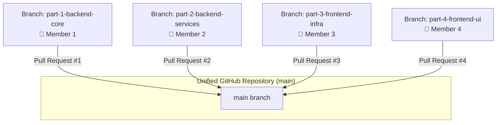

# 🚀 GitHub Team Collaboration Guide — 4-Member Contribution Workflow

> **Project:** AutoServe — Vehicle Service Booking, Scheduling & Tracking System  
> **Target:** 4 Team Members pushing 4 distinct parts to GitHub without altering file paths or breaking the codebase.

---

## 🎯 1. The Strategy: Why We Use Branches Instead of Folder Splitting

### ⚠️ The Problem with Creating `part1/`, `part2/`, `part3/`, `part4/` Folders
If you create folders named `part1/`, `part2/`, etc.:
1. **Java Package Names Break**: Java packages depend strictly on directory structure (e.g. `package com.vehicleservice.controller;` expects `backend/src/main/java/...`). Moving files into `part1/` causes compile-time errors.
2. **React Import Paths Break**: Imports like `import { Navbar } from '../components/Navbar';` will fail if files are separated into different part folders.
3. **Maven & Vite Build Failures**: Build tools look for `pom.xml` and `vite.config.js` in designated root directories.
4. **Messy GitHub Repository**: On GitHub, your repo would appear fragmented with duplicated or displaced folders.

### ✅ The Professional Solution: The **Branch-Per-Member Workflow**
- Every file keeps its **exact natural path** (`backend/src/...`, `frontend/src/...`).
- Each team member is assigned a dedicated **Git Branch** representing their part.
- Each member commits and pushes their assigned files from their branch.
- When pushed to GitHub:
  - Each member's GitHub profile receives **contribution credit**.
  - GitHub displays 4 distinct branches with each member's commits.
  - When merged into `main` (via Pull Requests), all files unite into a single, cohesive, production-ready codebase with **zero broken imports and zero merge conflicts**!

---

## 👥 2. Team Member Assignments & File Allocation



---

### 👤 Member 1: Backend Core, Data Models & Persistence Layer
* **Branch Name:** `part-1-backend-core`
* **Commit Message:** `feat(backend): add Spring Boot core, security config, domain models, and JSON storage engine`
* **Files Assigned:**
  - `backend/pom.xml`
  - `backend/src/main/resources/application.properties`
  - `backend/src/main/resources/seed/catalog-seed.json`
  - `backend/data/catalog.json`
  - `backend/data/workshops.json`
  - `backend/src/main/java/com/vehicleservice/VehicleServiceApplication.java`
  - `backend/src/main/java/com/vehicleservice/config/` (AppProperties, CorsConfig, JwtAuthFilter, SecurityConfig)
  - `backend/src/main/java/com/vehicleservice/model/` (User, Role, Vehicle, Category, VehicleTree, ServiceItem, QueueClass, Workshop, Mechanic, Slot, Booking, Job, JobStatus, Bill, BillLine, ServiceRecord)
  - `backend/src/main/java/com/vehicleservice/store/` (JsonFileStorage, UserStore, VehicleStore, CatalogStore, WorkshopStore, MechanicStore, BookingStore, JobStore, BillStore)
  - `.gitignore`

---

### 👤 Member 2: Backend Business Logic, Scheduling Engine & REST Controllers
* **Branch Name:** `part-2-backend-services`
* **Commit Message:** `feat(backend): implement dual-queue slot allocator, service layer, DTOs, and REST controllers`
* **Files Assigned:**
  - `backend/src/main/java/com/vehicleservice/scheduler/` (SlotAllocator, ShortJobComparator, LongJobComparator, AgingTask)
  - `backend/src/main/java/com/vehicleservice/service/` (AuthService, JwtService, VehicleService, CatalogService, BookingService, MechanicService, BillingService, AdminService, SchedulerService)
  - `backend/src/main/java/com/vehicleservice/controller/` (AuthController, VehicleController, CatalogController, BookingController, MechanicController, BillController, AdminController)
  - `backend/src/main/java/com/vehicleservice/dto/` (AuthResponse, BillResponse, BookingRequest, BookingResponse, JobStatusRequest, LoginRequest, MechanicRequest, SignupRequest, VehicleRequest, WorkshopRequest)
  - `backend/src/main/java/com/vehicleservice/exception/` (ApiException, GlobalExceptionHandler)

---

### 👤 Member 3: Frontend Client Infrastructure, State & API Layer
* **Branch Name:** `part-3-frontend-infra`
* **Commit Message:** `feat(frontend): set up Vite, modern design system, AuthContext, Axios client, and mock store`
* **Files Assigned:**
  - `frontend/package.json`
  - `frontend/package-lock.json`
  - `frontend/vite.config.js`
  - `frontend/index.html`
  - `frontend/.env`
  - `frontend/.env.example`
  - `frontend/src/main.jsx`
  - `frontend/src/App.jsx`
  - `frontend/src/styles/app.css`
  - `frontend/src/context/AuthContext.jsx`
  - `frontend/src/routes/ProtectedRoute.jsx`
  - `frontend/src/utils/constants.js`
  - `frontend/src/utils/formatters.js`
  - `frontend/src/api/` (axiosClient, authApi, vehicleApi, catalogApi, bookingApi, mechanicApi, billApi, adminApi, mockData)

---

### 👤 Member 4: Frontend UI Pages, Feature Components & Test Suite
* **Branch Name:** `part-4-frontend-ui`
* **Commit Message:** `feat(frontend): build all UI pages, 16 interactive components, and comprehensive test suite`
* **Files Assigned:**
  - `frontend/src/pages/` (AuthPage, DashboardPage, MechanicPage, AdminPage)
  - `frontend/src/components/` (Navbar, LoginForm, SignupForm, VehicleCard, AddVehicleForm, BookingForm, ServicePicker, BookingConfirmation, ServiceHistoryList, BillView, JobTable, JobStatusButtons, StatusBadge, WorkshopForm, MechanicForm, DataTable)
  - `backend/src/test/` (AuthAndVehicleTests, BookingAndSchedulerTests, MechanicAdminBillingTests, SchedulerQueuesHashingBillingComprehensiveTests, VehicleServiceApplicationTests)
  - `README.md`
  - `PRD_Vehicle_Service_Booking_V2.md`
  - `Architecture_Vehicle_Service_Booking.md`
  - `CODEBASE_EXPLANATION.md`
  - `GITHUB_COLLABORATION_GUIDE.md`

---

## 🛠️ 3. Step-by-Step Instructions for Each Member

### 📌 Prerequisites (Done by Team Lead or Member 1 Once)
1. Go to [GitHub](https://github.com/new) and click **"New repository"**.
2. Name it (for example: `vehicle-service-management-system`).
3. Keep it **Public** or **Private**, do **NOT** check "Add a README" or ".gitignore" (we already have them).
4. Copy the repository URL (e.g. `https://github.com/YOUR_USERNAME/vehicle-service-management-system.git`).

---

### 🟢 Option A: Automated One-Click Branch Setup (Recommended)
We have provided an automated script [`setup_git_branches.bat`](file:///c:/Users/vedan/OneDrive/Desktop/Vehicle%20Service%20Service/setup_git_branches.bat) (or run the PowerShell script [`setup_git_branches.ps1`](file:///c:/Users/vedan/OneDrive/Desktop/Vehicle%20Service%20Service/setup_git_branches.ps1)).

Simply open your terminal in the project root and run:
```powershell
.\setup_git_branches.ps1
```
This automatically:
1. Initializes Git (`git init`).
2. Creates the initial `main` baseline.
3. Creates all 4 branches:
   - `part-1-backend-core` (with Member 1 files)
   - `part-2-backend-services` (with Member 2 files)
   - `part-3-frontend-infra` (with Member 3 files)
   - `part-4-frontend-ui` (with Member 4 files)
4. Merges all 4 cleanly into `main`.

Then all you need to do is link your remote and push!

---

### 🟢 Option B: Manual Instructions for Each Member

#### 👤 MEMBER 1 (Backend Core & Models)
On Member 1's computer:
```bash
# 1. Set Member 1's Git identity
git config user.name "Member 1 Name"
git config user.email "member1@example.com"

# 2. Create and switch to Part 1 branch
git checkout -b part-1-backend-core

# 3. Stage Part 1 files
git add .gitignore
git add backend/pom.xml
git add backend/src/main/resources/
git add backend/data/
git add backend/src/main/java/com/vehicleservice/VehicleServiceApplication.java
git add backend/src/main/java/com/vehicleservice/config/
git add backend/src/main/java/com/vehicleservice/model/
git add backend/src/main/java/com/vehicleservice/store/

# 4. Commit and push to GitHub
git commit -m "feat(backend): add Spring Boot core, security config, domain models, and JSON storage engine"
git remote add origin https://github.com/YOUR_USERNAME/vehicle-service-management-system.git
git push -u origin part-1-backend-core
```

---

#### 👤 MEMBER 2 (Backend Services & Controllers)
On Member 2's computer (or switching branch):
```bash
# 1. Set Member 2's Git identity
git config user.name "Member 2 Name"
git config user.email "member2@example.com"

# 2. Create and switch to Part 2 branch
git checkout -b part-2-backend-services

# 3. Stage Part 2 files
git add backend/src/main/java/com/vehicleservice/scheduler/
git add backend/src/main/java/com/vehicleservice/service/
git add backend/src/main/java/com/vehicleservice/controller/
git add backend/src/main/java/com/vehicleservice/dto/
git add backend/src/main/java/com/vehicleservice/exception/

# 4. Commit and push to GitHub
git commit -m "feat(backend): implement dual-queue slot allocator, service layer, DTOs, and REST controllers"
git push -u origin part-2-backend-services
```

---

#### 👤 MEMBER 3 (Frontend Infrastructure & State)
On Member 3's computer (or switching branch):
```bash
# 1. Set Member 3's Git identity
git config user.name "Member 3 Name"
git config user.email "member3@example.com"

# 2. Create and switch to Part 3 branch
git checkout -b part-3-frontend-infra

# 3. Stage Part 3 files
git add frontend/package.json
git add frontend/package-lock.json
git add frontend/vite.config.js
git add frontend/index.html
git add frontend/.env.example
git add frontend/src/main.jsx
git add frontend/src/App.jsx
git add frontend/src/styles/app.css
git add frontend/src/context/
git add frontend/src/routes/
git add frontend/src/utils/
git add frontend/src/api/

# 4. Commit and push to GitHub
git commit -m "feat(frontend): set up Vite, modern design system, AuthContext, Axios client, and mock store"
git push -u origin part-3-frontend-infra
```

---

#### 👤 MEMBER 4 (Frontend UI Pages, Components & Tests)
On Member 4's computer (or switching branch):
```bash
# 1. Set Member 4's Git identity
git config user.name "Member 4 Name"
git config user.email "member4@example.com"

# 2. Create and switch to Part 4 branch
git checkout -b part-4-frontend-ui

# 3. Stage Part 4 files
git add frontend/src/pages/
git add frontend/src/components/
git add backend/src/test/
git add README.md
git add PRD_Vehicle_Service_Booking_V2.md
git add Architecture_Vehicle_Service_Booking.md
git add CODEBASE_EXPLANATION.md
git add GITHUB_COLLABORATION_GUIDE.md

# 4. Commit and push to GitHub
git commit -m "feat(frontend): build all UI pages, 16 interactive components, and comprehensive test suite"
git push -u origin part-4-frontend-ui
```

---

## 🔀 4. Merging on GitHub via Pull Requests

Once all 4 members have pushed their branches to GitHub:

1. Open your repository on GitHub in your web browser.
2. You will see banner notifications:
   `part-1-backend-core had recent pushes` &rarr; Click **"Compare & pull request"**.
3. Create the 4 Pull Requests into `main`:
   - **PR #1**: `part-1-backend-core` &rarr; `main` (Merge first: sets up backend foundation)
   - **PR #2**: `part-2-backend-services` &rarr; `main` (Merge second: adds logic & APIs)
   - **PR #3**: `part-3-frontend-infra` &rarr; `main` (Merge third: adds client infrastructure)
   - **PR #4**: `part-4-frontend-ui` &rarr; `main` (Merge fourth: adds UI pages & tests)
4. Click **"Merge pull request"** and **"Confirm merge"** for each PR.

---

## ✨ 5. The Final Result on GitHub
When all 4 PRs are merged into `main`:
- **Every member is listed as a contributor** with their individual commit history.
- **The repository structure is completely unified**:
  ```text
  Vehicle Service Service/
  ├── backend/
  │   ├── pom.xml
  │   ├── src/main/java/com/vehicleservice/...
  │   └── src/test/java/com/vehicleservice/...
  ├── frontend/
  │   ├── package.json
  │   ├── src/pages/...
  │   └── src/components/...
  ├── CODEBASE_EXPLANATION.md
  ├── GITHUB_COLLABORATION_GUIDE.md
  └── README.md
  ```
- **No separate `part1/` or `part2/` folders exist** — avoiding duplicate or broken files.
- Anyone can clone the repo and immediately run `mvn clean spring-boot:run` and `npm run dev` with 100% success.
